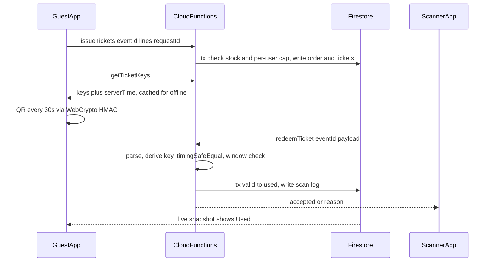

# Bilete cu QR securizat

## Problema de azi

- Biletele stau în `localStorage` ([`src/data/tickets.ts`](src/data/tickets.ts)). Oricine le poate edita sau inventa.
- Codul de pe bilet e un hash FNV de 6 caractere (`admissionCode`), deci se poate ghici și falsifica.
- „Mark as used” îl apasă chiar cumpărătorul ([`PassScreen.tsx`](src/app/screens/tickets/PassScreen.tsx)).
- Stocul (`sold`) e local, deci nu există nicio limită reală de capacitate.
- Textul `REFUND_RULE` promite refund-uri care nu există.

## Modelul de securitate

- **ID-ul biletului** este `randomBytes(16).toString('base64url')`: 22 de caractere, 128 de biți. Îl generează doar serverul. ID-ul nu e un secret. Cine îl știe tot nu intră, fiindcă scanarea cere și semnătura HMAC.
- **Cheia per bilet**: `HMAC-SHA256(MASTER_KEY, "cf-ticket-key|v1|" + ticketId + "|" + keyVersion)`, 32 de bytes. Nu se salvează nicăieri în Firestore. Serverul o rederivă la fiecare scanare. Dacă baza de date se scurge, nu se pot falsifica bilete.
- **`MASTER_KEY`**: 32 de bytes aleatori, ținuți în Secret Manager prin `defineSecret('TICKET_HMAC_KEY')`. Nu ajung niciodată la client și nu apar în loguri.
- **QR-ul rotativ** are forma `CF1.<ticketId>.<counter>.<mac>`, unde:
  - `counter = floor((Date.now() + serverOffset) / 30000)`;
  - `mac = base64url(HMAC-SHA256(ticketKey, "CF1|" + ticketId + "|" + counter)[0..16])`, adică 128 de biți.
  - Un screenshot expiră în 30–60 de secunde, pentru că serverul acceptă doar counter ±1 ca să tolereze ceasuri decalate.
- **Comparare în timp constant** cu `crypto.timingSafeEqual`. Payload-ul e parsat strict (regex și lungimi fixe) înainte de orice citire din baza de date.
- **Folosire unică**: un bilet trece din `valid` în `used` într-o tranzacție Firestore. Două scanări simultane nu pot trece amândouă.
- **Reset QR**: proprietarul poate incrementa `keyVersion`. Asta invalidează orice copie a cheii de pe alt dispozitiv.
- **App Check** (reCAPTCHA v3) cu `enforceAppCheck: true` pe toate funcțiile callable. Pentru localhost se folosește un token de debug.
- **Clientul nu scrie nimic** în `tickets`, `orders`, `ticketStock`, `ticketHolders` sau `scans`. Toate scrierile trec prin Admin SDK.

## Datele din Firestore (scrise doar de server)

- `tickets/{ticketId}`: `uid`, `orderId`, `eventId`, `tierId`, `tierName`, `price`, `currency`, un snapshot al evenimentului (nume, venue, adresă, coordonate, `startsAt`, `endsAt`, imagine), `buyerName`, `status: 'valid' | 'used'`, `keyVersion`, `usedAt`, `usedBy`, `createdAt`. Citire: proprietarul.
- `orders/{orderId}`: `uid`, `eventId`, `lines`, `subtotal`, `fee`, `total`, `ticketIds`, `requestId`, `createdAt`. Citire: proprietarul. `orderId = sha256(uid + requestId)` în base64url, deci un dublu-click sau un retry nu creează a doua comandă.
- `ticketStock/{eventId}`: `{ [tierId]: { capacity, sold } }`, `used`. Citire publică, ca să se afișeze câte au rămas.
- `ticketHolders/{eventId}_{uid}`: `count`. Limitează la 8 bilete per cont per eveniment.
- `eventStaff/{eventId}_{uid}`: staff de ușă adăugat de organizator.
- `scans/{autoId}`: `eventId`, `ticketId`, `scannerUid`, `result`, `reason`, `at`. Citire: organizatorul evenimentului și adminul.

Reguli noi în [`firestore.rules`](firestore.rules): toate colecțiile de mai sus au `write: if false`. În plus, un eveniment nu se mai poate șterge dacă există `ticketStock/{id}`, adică dacă s-au vândut bilete.

## Cloud Functions (folder nou `functions/`, Node 22, regiunea `europe-west1`)

- `issueTickets({ eventId, lines, requestId })`. Cere cont logat. Citește evenimentul din `events/{eventId}`. Tier-urile și prețurile se calculează pe server cu aceeași logică ca în client; prețurile venite de la client sunt ignorate. Vânzarea se închide la `endsAt`. Într-o singură tranzacție:
  - verifică stocul;
  - verifică limita de 8 per cont;
  - scrie comanda și biletele;
  - incrementează `sold`.
- `getTicketKeys()`. Întoarce `{ serverTime, keys: [{ ticketId, keyVersion, key }] }` doar pentru biletele `valid` ale userului, la evenimente care nu s-au terminat.
- `resetTicketKey({ ticketId })`. Doar proprietarul, doar cât biletul e `valid`. Incrementează `keyVersion`.
- `redeemTicket({ eventId, payload })`.
  - Permisiune: admin, `createdBy` al evenimentului sau o intrare în `eventStaff`.
  - Biletul trebuie să fie pentru acel `eventId`. Scanarea e deschisă de la `startsAt - 6h` până la `endsAt`.
  - Răspunsuri posibile: `accepted` (cu tier și `buyerName` pentru verificarea actului), `already_used` (cu ora și cine a scanat), `expired_code`, `bad_signature`, `wrong_event`, `not_open`, `not_found`.
  - Fiecare încercare intră în `scans`.
- `setDoorStaff({ eventId, email, add })`. Doar organizatorul evenimentului sau adminul. Găsește uid-ul prin `getAuth().getUserByEmail`.

Logica comună (tier-uri, taxă, format payload, constante) stă într-un modul pur nou, [`shared/ticketing.ts`](shared/ticketing.ts). Îl importă și Vite, și funcțiile; funcțiile se împachetează cu esbuild în `predeploy`. [`firebase.json`](firebase.json) primește secțiunile `functions` și `emulators` (auth, firestore, functions).

## Client

- [`src/data/firebase.ts`](src/data/firebase.ts): `getFunctions(app, 'europe-west1')` plus `initializeAppCheck` cu `VITE_APPCHECK_SITE_KEY`, și conectare la emulator în dev, dacă `VITE_USE_EMULATORS` e setat.
- [`src/data/tickets.ts`](src/data/tickets.ts): scot `localStorage`, `issuePasses`, `admissionCode` și `markUsed`. Rămân formatarea, `passPile` și parsarea documentelor din `tickets`. `REFUND_RULE` devine „Passes are final. Refunds are not available yet.”
- Fișier nou [`src/data/ticketCodes.ts`](src/data/ticketCodes.ts): HMAC prin WebCrypto (`crypto.subtle`), `buildPayload`, și cache-ul cheilor plus offset-ul de ceas în `localStorage`, cu cheia de stocare legată de uid. Cache-ul se șterge la sign out. Așa QR-ul merge și fără semnal în club.
- [`src/app/tickets.tsx`](src/app/tickets.tsx): un `onSnapshot` pe `tickets where uid == me` (persistența offline e deja activă) și pe `ticketStock` pentru câte au rămas. `purchase` devine async și apelează `issueTickets` cu un `requestId` din `crypto.randomUUID()`.
- [`TicketSheet.tsx`](src/app/screens/event/TicketSheet.tsx): dacă nu ești logat, apare „Sign in to get passes” cu link spre `/profile`. Numele și emailul vin din cont. Butonul arată starea de încărcare și erorile primite de la server.
- [`PassCard.tsx`](src/app/screens/tickets/PassCard.tsx): `AdmissionMark` e înlocuit de `RotatingQr`, un SVG generat cu `uqr` cu un inel de countdown de 30 de secunde. În listă, QR-ul se blurează; se vede clar doar pe ecranul biletului.
- [`PassScreen.tsx`](src/app/screens/tickets/PassScreen.tsx): scot „Mark as used”. Statusul „Used” apare live când biletul e scanat. Adaug „Reset QR” și sfatul „Turn brightness up”.
- Ecran nou `/scan/:eventId` ([`src/app/screens/scan/ScanScreen.tsx`](src/app/screens/scan/ScanScreen.tsx)) cu camera prin `qr-scanner`. Rezultatul apare pe tot ecranul, verde sau roșu, cu motivul. Dacă același cod e citit iar în mai puțin de 3 secunde, nu se mai trimite. Sus apare un contor de intrați din `ticketStock`. Se intră din [`EventPanel.tsx`](src/app/screens/event/EventPanel.tsx) prin „Scan tickets”, vizibil pentru organizator, admin și staff. În `EventEditor`, organizatorul are o listă scurtă de staff, cu add și remove după email.
- Biletele demo vechi din `localStorage` se ignoră. Nu au fost niciodată valide.

## Teste

- `functions`: vitest pentru derivarea cheii, construirea și verificarea payload-ului (counter ±1, expirat, MAC modificat, lungimi greșite) și pentru calculul comenzii.
- Client: că `buildPayload` cu WebCrypto produce exact același MAC ca implementarea Node, pe vectori ficși.
- [`src/data/tickets.test.ts`](src/data/tickets.test.ts): actualizat pentru noul modul.

## Setup manual (îl faci tu o dată)

1. Treci proiectul Firebase pe planul Blaze.
2. `firebase functions:secrets:set TICKET_HMAC_KEY` cu o valoare generată de `openssl rand -base64 32`.
3. Activezi App Check cu reCAPTCHA v3 în consolă și pui site key-ul în `.env` ca `VITE_APPCHECK_SITE_KEY`.
4. `firebase deploy --only functions,firestore:rules`.

## Ce rămâne în afară

Plata (Stripe), refund-urile, transferul biletelor între conturi, scanarea offline la ușă (scannerul are nevoie de net) și verificarea obligatorie a emailului.