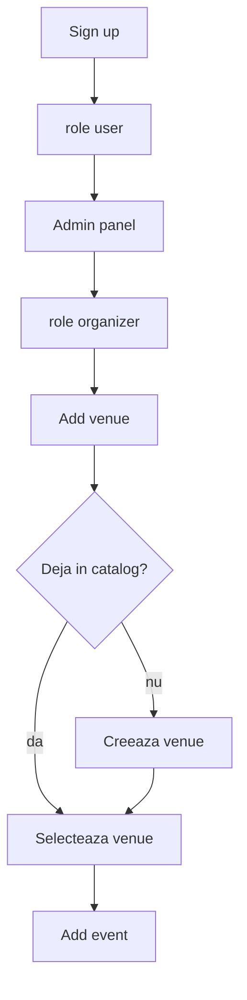

# Conturi, roluri și venue-uri

Aplicația rămâne publică la vizionare. Scrierea în Firestore se închide: azi [`firestore.rules`](firestore.rules) lasă pe oricine să modifice `venues` și `events`. Autentificarea e Firebase Auth (email și parolă), pe proiectul Firebase deja folosit în [`src/data/firebase.ts`](src/data/firebase.ts). Interfața rămâne în engleză, ca restul aplicației.

## Roluri

- **user** — rolul implicit la înregistrare. Vede evenimentele, își editează numele, poza și preferințele (genuri, buget). Nu vede „Add”, nici „Edit event”.
- **organizer** (event manager) — îl promovezi tu din panoul de admin. Poate adăuga un venue dacă nu există și poate pune un eveniment la orice venue din catalog. Editează și șterge doar ce a creat el.
- **admin** — ownerul. Editează și șterge orice venue și orice eveniment, inclusiv datele deja seed-uite (nu au `createdBy`). Promovează sau retrogradează pe alții între user și organizer.

Primul admin nu se poate auto-acorda din aplicație. După ce îți faci contul, setezi o dată `role: "admin"` pe documentul tău `users/{uid}` din consola Firebase. Regulile refuză `role: "admin"` venit din client.

## Date

Colecție nouă `users/{uid}`: `displayName`, `email`, `photoURL`, `role`, `genres`, `budget`.

Pe [`Venue`](src/data/types.ts) se adaugă `venueType` și `createdBy`. Pe [`StoredEvent`](src/data/types.ts) se adaugă `createdBy`. Documentele vechi rămân valide: `venueType` lipsește și se citește ca `club`; fără `createdBy`, doar adminul le poate modifica.

Tipuri de venue: club, bar, concert hall, arena, theatre, festival / outdoor, **other**.

Venue-ul e locația evenimentului, un catalog comun. Doi manageri pot folosi BT Arena; niciunul nu o „deține”. Dacă `googlePlaceId` există deja, formularul nu creează duplicat: arată venue-ul existent și îl lași selectat pentru eveniment.

## Add venue

În [`VenueEditor.tsx`](src/app/screens/profile/VenueEditor.tsx), primul câmp e tipul.

- **Orice tip în afară de other.** Câmp pentru linkul de Google Maps și butonul „Fill from Maps”. Se păstrează Places API (New) din [`src/data/places.ts`](src/data/places.ts), care aduce deja nume, adresă, coordonate, program, telefon, site, rating, descriere, poze și atribuiri. Biasul fix pe București dispare: un link cu `@lat,lng` caută în jurul punctului ăluia, ca BT Arena din Cluj să nu pice pe alt oraș. Linkul se parsează astfel: `place_id` / `query_place_id` / `ChIJ…` merg direct la Place Details; `/maps/place/Nume/@lat,lng` caută numele lângă coordonate; dacă Maps întoarce mai multe locuri, managerul alege dintr-o listă scurtă. Linkurile scurte `maps.app.goo.gl` nu se pot deschide din browser (redirect blocat). Formularul spune să deschidă linkul și să copieze URL-ul lung din bara de adresă. După import, câmpurile rămân editabile înainte de save.
- **Other.** Fără import Maps. Completează tot manual, inclusiv pozele (URL sau upload-ul Cloudinary existent). Locația se pune pe o hartă MapLibre mică, cu pin, plus lat/lng dacă vrea să le scrie.

Rutele `/profile/clubs/...` devin `/profile/venues/...`, cu redirect de la vechile URL-uri. În editorul de eveniment, „Club” devine „Venue”: listă căutabilă cu toate venue-urile. Dacă lipsește locul, „Add venue” și, după salvare, revine la eveniment cu venue-ul selectat.

## Panoul de cont

[`ProfileScreen.tsx`](src/app/screens/profile/ProfileScreen.tsx) nu mai listează tot catalogul sub „My clubs”.

- Neautentificat: sign in / create account. Genurile și bugetul de pe home rămân în `sessionStorage`, ca acum.
- User: nume, poză, email (doar citire), genuri, buget. La login, preferințele din cont intră în sesiune, ca ranking-ul „For you” să le folosească. Schimbările de pe home, cât e logat, se salvează înapoi în cont.
- Organizer: aceleași câmpuri, plus venue-urile și evenimentele create de el.
- Admin: tot catalogul, plus lista de oameni și acțiunea de promovare la event manager.

„Edit event” din [`EventPanel.tsx`](src/app/screens/event/EventPanel.tsx) apare doar dacă ești autorul sau admin. Locația GPS rămâne pe dispozitiv, nu în cont.

## Reguli Firestore

- Citire publică pentru `venues` și `events`.
- Userul își scrie profilul, dar nu își schimbă `role`.
- Organizerul creează venue/event doar cu `createdBy == uid` și le modifică doar pe ale lui.
- Adminul scrie orice venue, orice event și `role` la alți useri (`user` sau `organizer`).
