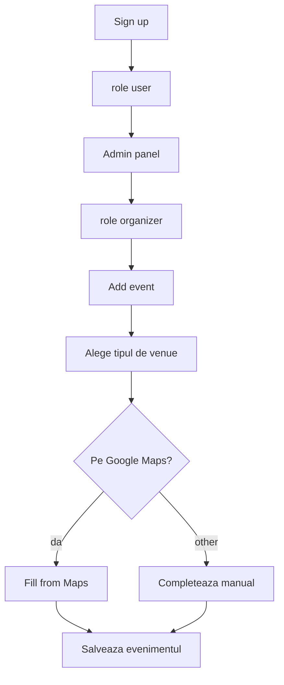

# Conturi, roluri și evenimente

Aplicația rămâne publică la vizionare. Scrierea în Firestore se închide: azi [`firestore.rules`](firestore.rules) lasă pe oricine să modifice `venues` și `events`. Autentificarea e Firebase Auth (email și parolă), pe proiectul Firebase deja folosit în [`src/data/firebase.ts`](src/data/firebase.ts). Interfața rămâne în engleză, ca restul aplicației.

Venue-ul nu mai e o colecție și nu mai e un catalog comun. Toate documentele din `venues` se șterg. Informațiile despre loc (nume, tip, adresă, coordonate, poze, program, telefon, site, link Maps) stau doar pe documentul evenimentului. Două seri la BT Arena au fiecare copia lor de locație; nu există un venue de editat separat.

## Roluri

- **user** — rolul implicit la înregistrare. Vede evenimentele, își editează numele, poza și preferințele (genuri, buget). Nu vede „Add”, nici „Edit event”.
- **organizer** (event manager) — îl promovezi tu din panoul de admin. Adaugă evenimente. La fiecare eveniment alege tipul de venue și folosește uneltele de mai jos ca să completeze locul repede. Editează și șterge doar evenimentele create de el.
- **admin** — ownerul. Editează și șterge orice eveniment, inclusiv cele migrate (nu au `createdBy`). Promovează sau retrogradează pe alții între user și organizer.

Primul admin nu se poate auto-acorda din aplicație. După ce îți faci contul, setezi o dată `role: "admin"` pe documentul tău `users/{uid}` din consola Firebase. Regulile refuză `role: "admin"` venit din client.

## Date

Colecție nouă `users/{uid}`: `displayName`, `email`, `photoURL`, `role`, `genres`, `budget`.

Colecția `venues` dispare. [`VenueEditor`](src/app/screens/profile/VenueEditor.tsx) și rutele `/profile/clubs/...` dispar odată cu ea.

Pe [`StoredEvent`](src/data/types.ts) se adaugă `createdBy` și un bloc `venue` cu câmpurile de azi ale unui venue, plus `venueType`. Nu mai există `venueId`. Harta și lista citesc coordonatele de pe eveniment. Pinurile care cad în același loc se grupează după `googlePlaceId`, iar dacă lipsește, după coordonate, ca două seri la aceeași sală să stea în continuare unul peste altul.

Tipuri de venue, alese în formularul de eveniment: club, bar, concert hall, arena, theatre, festival / outdoor, **other**.

Documentele vechi de eveniment se rescriu o dată, apoi nu se mai citesc cu `venueId`.

## Unelte la adăugarea unui eveniment

Formularul din [`EventEditor.tsx`](src/app/screens/profile/EventEditor.tsx) ține și noaptea (nume, dată, preț, genuri, poster), și locul. Primul câmp al locului e tipul. Nu există „Add venue” și nu se alege un venue dintr-o listă.

- **Orice tip în afară de other.** Câmp pentru linkul de Google Maps și butonul „Fill from Maps”. Se păstrează Places API (New) din [`src/data/places.ts`](src/data/places.ts), care aduce nume, adresă, coordonate, program, telefon, site, rating, descriere, poze și atribuiri și le pune pe eveniment. Biasul fix pe București dispare: un link cu `@lat,lng` caută în jurul punctului ăluia, ca BT Arena din Cluj să nu pice pe alt oraș. Linkul se parsează astfel: `place_id` / `query_place_id` / `ChIJ…` merg direct la Place Details; `/maps/place/Nume/@lat,lng` caută numele lângă coordonate; dacă Maps întoarce mai multe locuri, managerul alege dintr-o listă scurtă. Linkurile scurte `maps.app.goo.gl` nu se pot deschide din browser (redirect blocat). Formularul spune să deschidă linkul și să copieze URL-ul lung din bara de adresă. După import, câmpurile rămân editabile înainte de save.
- **Other.** Fără import Maps. Completează locul manual, inclusiv pozele (URL sau upload-ul Cloudinary existent). Locația se pune pe o hartă MapLibre mică, cu pin, plus lat/lng dacă vrea să le scrie.

## Evenimentele care există deja

Înainte de a șterge `venues`, fiecare eveniment din `events` se rescrie în formatul nou. Locația se ia de pe venue-ul legat prin `venueId`, apoi se împrospătează de pe net cu același Places API: `googlePlaceId` dacă există, altfel căutare după nume și coordonatele venue-ului, fără bias pe București. Numele, adresa, coordonatele, programul, telefonul, site-ul, ratingul, descrierea, pozele și atribuirile de pe Maps se scriu în `venue` pe eveniment. Ce Maps nu întoarce rămâne din documentul vechi. `venueType` se pune din tipul Google al locului când se poate recunoaște, altfel `club`. Apoi se șterg toate documentele din `venues`.

## Panoul de cont

[`ProfileScreen.tsx`](src/app/screens/profile/ProfileScreen.tsx) nu mai are „My clubs”.

- Neautentificat: sign in / create account. Genurile și bugetul de pe home rămân în `sessionStorage`, ca acum.
- User: nume, poză, email (doar citire), genuri, buget. La login, preferințele din cont intră în sesiune, ca ranking-ul „For you” să le folosească. Schimbările de pe home, cât e logat, se salvează înapoi în cont.
- Organizer: aceleași câmpuri, plus evenimentele create de el și „Add event”.
- Admin: toate evenimentele, plus lista de oameni și acțiunea de promovare la event manager.

„Edit event” din [`EventPanel.tsx`](src/app/screens/event/EventPanel.tsx) apare doar dacă ești autorul sau admin. Locația GPS rămâne pe dispozitiv, nu în cont.

## Reguli Firestore

- Citire publică pentru `events`. Colecția `venues` nu mai primește citiri sau scrieri.
- Userul își scrie profilul, dar nu își schimbă `role`.
- Organizerul creează un eveniment doar cu `createdBy == uid` și îl modifică doar pe al lui. Blocul `venue` face parte din eveniment, nu e un document separat.
- Adminul scrie orice eveniment și `role` la alți useri (`user` sau `organizer`).
