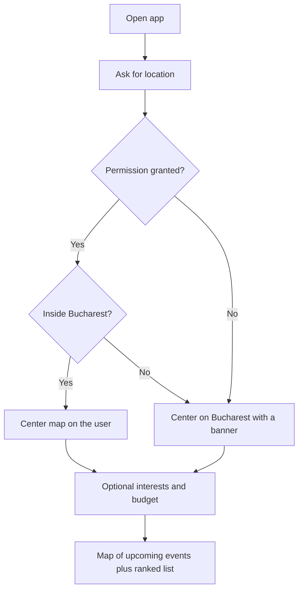

# Club Finder

A guest-facing discovery app for a night out. Someone opens it because they want to go out and do not yet know where. The app asks for their location, opens a map of the current city, and shows upcoming events at clubs that are actually hosting something. A ranked list under the map explains each option in plain language: name, photos, average price, distance, and the same kind of place details a maps listing would show.

Club owners and organizers are the other side of the product. They will eventually list venues and events, and the platform will sell tickets. This document specifies the first demo only: discovery in Bucharest, with placeholder venues and events. Ticketing and an admin dashboard are later phases, described here so the first version does not block them.

## First demo

The first version is a phone-first, desktop-usable React progressive web app. It is implemented in this repo. It installs to a home screen, works in the browser, and stays responsive on both screen sizes. There is no account, no organizer tools, and no checkout.

On open, the app asks for location and resolves the city. This demo has one city mapped: **Bucharest**. The landing page is split between a map of upcoming events and a list of those events.

Product rules for what appears:

- A club is on the map only when it has at least one upcoming event. A venue with nothing scheduled is absent.
- An event that starts on the user’s local calendar day gets a highlighted pin outline. Other upcoming events stay visible with a quieter pin.
- Pins cluster when the user zooms out. A cluster that contains any same-day event uses the same highlight and shows how many of those events sit inside it.
- The map shows every upcoming event in the city. The list is what ranks them.



## Decisions

These choices keep the demo small and give “best fit” a concrete answer before any real user history exists.

- **The map is complete. The list is opinionated.** Default list sort is “For you”. The user can also sort by soonest, nearest, or price. Hiding clubs the score merely ranks lower would make the map look empty of real options.
- **Personalization is three skippable interest chips.** After location, the guest may pick up to three genres: techno, house, hip-hop, live, commercial, queer, Latin. Skipping means the rank uses tonight, distance, and how soon the event starts.
- **The score is a formula the interface can explain.** There is no trained model in the demo. Each card states why it ranked where it did, for example “1.4 km · tonight · techno · about 80 EUR”.
- **One pin per venue, aimed at that venue’s next event.** If the venue has another event coming up, tapping the pin opens a short stack. Clustering runs on this one-pin-per-venue set. The pin is highlighted when any still-upcoming event at that venue starts today.
- **Seed dates are offsets from today.** Tonight, tomorrow, and this weekend are computed when the app loads. Fixed calendar dates would make the same-day outline go stale. The seed also uses a weekday offset (coming Saturday/Sunday) so “this weekend” stays on the weekend, and a minutes-from-load offset so “on now” and “starts soon” stay visible whatever the clock says.
- **Two prices, labeled apart.** The event has an average ticket or door price in EUR. The venue has a separate price level for a night out, in the 1–4 style used on maps. The card never presents one number as the other.
- **The demo has no backend.** Venues and events ship as a typed module. Covers are generated UV posters labelled “placeholder”, not real photos, so the installed app can still draw the list offline.
- **English interface, EUR prices.** Bucharest is the only city. Romanian copy can replace the strings later without changing the model.
- **The same React app is the thing that gets wrapped later.** The native port should use Capacitor once the guest flow is stable, unless a store release needs a fully native map. Admin and ticketing are separate surfaces, not extra tabs in this demo.

## Who it is for in this version

The only user in the demo is the guest who wants to go out. They can:

1. Share their location, or continue straight into the Bucharest demo.
2. Optionally say what they feel like and what they want to spend.
3. Scan the map for what is on today versus later.
4. Read a ranked list and open an event for the practical details.

Organizers, door staff, and platform admins show up only in the later phases.

## Location

The first screen tells the guest why location is needed: to center the map on their city and to measure distance. Two actions: **Allow location**, and **Continue with Bucharest**.

Resolution rules:

- Permission granted and the point falls inside the Bucharest bounding box: center the map on the guest and measure distance from that point.
- Permission granted and the point is outside the box: open Bucharest at the default center and show a banner that this demo only maps Bucharest.
- Permission denied, dismissed, or unavailable: same fallback and banner. Distance is measured from the default center.

No geocoding service. A bounding box is enough and keeps the demo free of API keys.

| Edge | Latitude | Longitude |
| --- | ---: | ---: |
| North | 44.54 | — |
| South | 44.33 | — |
| West | — | 25.96 |
| East | — | 26.23 |

Default center, Piața Unirii: latitude `44.4268`, longitude `26.1025`.

The choice, the resolved center, selected genres, and the optional budget live for the browser session. A refresh in the same tab returns to the landing page. A new session asks again.

## Best fit

“For you” is a weighted sum. Higher scores sort first. Ended events are excluded before scoring, so they never compete.

```
score =
  40 * sameDay
  + 20 * timeProximity
  + 15 * distanceScore
  + 15 * genreOverlap
  + 7  * priceFit
  + 3  * ratingScore
```

Each term is from 0 to 1. When the guest skipped interests, `genreOverlap` is 0 for every event, so that term does not change the order. When they skipped budget, `priceFit` is 0 for every event in the same way.

**Same day (`sameDay`).** 1 when the event’s start falls on the guest’s local calendar date and the event has not ended. 0 otherwise. This is also the only signal that draws the pin outline.

**Time until start (`timeProximity`).** Let `hoursUntil` be the hours from now until the start.

- Already started, still running: `0.25`. These stay on the map and sink in the list.
- Starts within 3 hours: `1`.
- Starts in 3 to 8 hours: `0.75`.
- Starts later today: `0.55`.
- Starts within 36 hours: `0.35`.
- Starts within 72 hours: `0.2`.
- Starts later than that: `0.1`.

**Distance (`distanceScore`).** `clamp(1 - kilometers / 12, 0, 1)`. A venue on top of the guest scores 1. A venue 12 km away or farther scores 0. The origin is the guest’s point, or Piața Unirii when location was not used.

**Genre overlap (`genreOverlap`).** Size of the intersection between the event’s genres and the guest’s picks, divided by the number of picks. 0 when the guest skipped.

**Price fit (`priceFit`).** Compared with the event’s `averagePrice` in EUR.

- Under 50: `1` at 50 or below, `0.4` at 100 or below, `0` above 100.
- 50–100: `1` inside that band, `0.5` under 50, `0.2` above 100.
- 100+: `1` at 100 or above, `0.5` from 50 to 100, `0.2` under 50.
- No budget chosen: `0` for every event.

**Rating (`ratingScore`).** The venue’s placeholder rating divided by 5. It only breaks close ties.

The map does not sort. Highlight means “an event here starts today” and nothing else. The list’s default order follows the score. Inside the list, a **Tonight** group sits above **Coming up**, so same-day events stay obvious after the guest scrolls past the map. Within each group, order is still the active sort.

The one-line reason on a card is built from the facts that are actually true for that event, in this order, skipping anything that does not apply:

1. Distance, rounded to one decimal kilometer under 10 km and to the nearest kilometer otherwise.
2. “Tonight” when `sameDay` is 1.
3. The first genre that overlaps the guest’s picks, or the event’s first genre when they skipped.
4. “About {averagePrice} EUR”.

Example: `1.4 km · tonight · techno · about 80 EUR`.

## Landing page

### Map

On a phone the map is the top region, about 42% of the viewport height, and it stays put while the list scrolls beneath it. On a desktop-width layout the map is the left column, about half the width, and the list scrolls on the right.

The basemap is a stylized MapLibre style that does not need a paid token. On it:

- A dot for the guest when their real position is in Bucharest. The fallback center does not pretend to be the guest.
- One pin per venue that has an upcoming event.
- A bright outline on a pin whose venue has a same-day event. Other pins are quieter.
- Clusters when points would overlap. A cluster with any same-day child uses the same outline and a count of those events, plus the total count.
- Tap a cluster to zoom until the children separate or a single pin remains.
- Tap a pin to select that venue, mark the matching card, and scroll the list to it. If the venue has more than one upcoming event, the pin opens a stack of those events, soonest first, and the list scrolls to the soonest one.

### List

Each card shows:

- Cover image
- Event name and venue name
- Start time in the guest’s local timezone
- The reason line (distance, tonight, genre, average price)
- Genre labels

Opening a card, or following it to its own page, shows the maps-level detail:

- Photo strip (event image first, then venue images)
- Address
- Placeholder rating
- Venue price level, labeled as the cost of a night out, separate from the ticket price
- Hours
- Short description of the venue and of the event
- Distance
- A link that opens the venue in an external map at its coordinates

There is no ticket button. A single line on the detail page says ticketing is coming later. It does not imitate a checkout.

### Filters and sorts

Time range, single choice: **Tonight**, **This weekend** (through Sunday night), **All upcoming**. Default is All upcoming, with the Tonight group still visually first.

Genre chips reflect the picks from the start of the session. Changing them updates the score. Clearing them returns to the skip behavior.

Sort, single choice: **For you** (default), **Soonest**, **Nearest**, **Price** (lowest average price first).

These controls always change the list. On the map they dim pins and clusters that do not match, and they leave those pins in place so clusters stay honest. A separate control, **Filter the map too**, removes non-matching venues from the map until it is turned off.

Empty list: a short line that nothing matches, plus a way to clear the time range and genre chips. The map stays as it was under the current map-filter setting.

## Demo data

About 12 to 16 venues, using real Bucharest coordinates so clustering and distance read correctly. Names, descriptions, ratings, prices, and photos are invented placeholders and should look like placeholders.

Spread them across:

- Centrul Vechi
- Universitate
- Cotroceni
- Herăstrău
- Floreasca

Every venue in the file has at least one upcoming event, which matches the map rule. At least two venues have two upcoming events, so the pin stack is visible. At least one of those pairs is same-day plus a later date, so the outline and the stack can be checked together. Include a mix of genres and average prices across the three budget bands.

Relative schedule, computed at load:

- Several events tonight, with start times both soon and later the same evening.
- At least one event that has already started and has not ended, so the “sink but keep” rule has something to show.
- Several tomorrow.
- Several over the coming weekend.
- One or two further out in the next two weeks, so the low time score is visible.

## Data model

Three types. Identifiers are stable strings.

**City**

- `id`
- `name`
- `boundingBox`: north, south, west, east
- `defaultCenter`: latitude, longitude
- `defaultCenterName`: display name of the fallback origin (Piața Unirii)

Only Bucharest exists in the demo.

**Venue**

- `id`
- `name`
- `cityId`
- `neighbourhood`: used only to spread the seed (Centrul Vechi, Universitate, Cotroceni, Herăstrău, Floreasca)
- `address`
- `latitude`, `longitude`
- `images`: local paths (empty in this demo; the UI draws labelled placeholders)
- `rating`: number from 0 to 5, placeholder
- `priceLevel`: 1, 2, 3, or 4
- `hours`: a short display string
- `genres`: one or more of the genre set
- `description`

**Event**

- `id`
- `venueId`
- `name`
- `start`: relative start, one of:
  - `{ daysFromToday, hour, minute }` — `0` meaning today
  - `{ weekday: 'saturday' | 'sunday', hour, minute }` — the coming Saturday or Sunday
  - `{ minutesFromLoad }` — offset from load time, so “on now” / “starts soon” do not depend on the clock
- `durationHours`
- `image`: local path (optional; omitted in this demo)
- `averagePrice`: number, EUR
- `currency`: `EUR`
- `genres`
- `description`

Absolute start and end are derived at runtime from those offsets and the guest’s local clock. Stored ISO dates are not used in the seed, because they go stale.

**What the map queries.** Upcoming events whose venue belongs to the active city and whose derived end is still in the future. Collapse to one pin per venue. The pin’s primary event is the soonest remaining one. `sameDay` on the pin is true when any remaining event at that venue starts on the local calendar date. Venues that collapse to an empty set are left out.

**Genre set.** `techno`, `house`, `hip-hop`, `live`, `commercial`, `queer`, `latin`. An event may carry more than one. A guest may select up to three.

## Screens

- **Location.** `/welcome`. First visit in a session. Allow, or continue with Bucharest.
- **Interests.** `/interests`. Up to three genres, optional budget band, skip.
- **Home.** `/`. Map plus list. This is the page a returning session opens.
- **Event.** `/events/:id`. Detail for one event. Unknown ids, and events that have already ended, show a short missing state and a way back to the list.

The design-system showcase stays at `/design-system`. It is not part of the guest flow.

No login, no organizer area, no admin area, no checkout.

## Technical notes

What the demo is built with:

- React 19, TypeScript, Vite
- React Router for `/welcome`, `/interests`, `/`, and `/events/:id`
- `vite-plugin-pwa` for the manifest, icons, and a service worker that precaches the app shell. OpenFreeMap tiles are cached at runtime. The service worker does not remove the need for the geolocation permission.
- MapLibre GL JS, with GeoJSON clustering on a one-pin-per-venue source. HTML markers from the design system draw pins and clusters. The basemap is OpenFreeMap vector tiles painted with the Blacklight `mapTheme` (no API key).
- Seed data in `src/data/bucharest.ts`. Ranking, distance, and date derivation live next to it, so the list and the map share one definition of “upcoming”, “same day”, and “for you”.
- Session state (location choice, genres, budget) in `sessionStorage`, so a refresh in the same tab returns to the landing page and a new session asks again.

No database, no authentication, and no payment SDK in this version. Location uses the browser Geolocation API.

## Later phases

These are specified only so the discovery model stays compatible with them. They are not part of the demo build.

### Accounts and saved events

Guests can create an account, keep genre chips and budget, and save events. Behavior is still the weighted score above until there is enough real activity to justify anything more adaptive. Saves do not by themselves rewrite the map.

### Organizer listings

A venue owner submits their venue and its events. That submission replaces the placeholder module. The map rule is unchanged: a venue with no upcoming event has no pin. Submitted images, prices, and hours occupy the same fields the detail page already renders.

### Ticketing

Ticketing follows the shape of a general-admission seller such as iabilet.ro.

- The event page gains ticket tiers: name, price, quantity remaining, sales window.
- Checkout charges the guest and issues a QR ticket.
- Door staff scan the QR and mark the ticket used.
- The platform takes a fee. Organizers are paid out after the event.
- Refunds follow a rule stored on the event.
- Reserved seating and seat maps wait until general admission is working.

The event route in the demo is the page where “Get tickets” will be added. Discovery ranking stays independent of who paid.

### Admin dashboard

A separate web area for platform staff, not a route in the guest app’s navigation. Staff can review venues and events, set featured placement, and, once ticketing exists, look up orders and scans. Featured placement, when it arrives, should be labeled on the card. It can add a bounded boost. It does not remove the explanation line.

### Native port

When the guest flow is stable, wrap this React app with Capacitor for installable iOS and Android builds. Move to a native map only if the wrapped MapLibre view is not good enough on device.

## Out of scope

Not part of this demo:

- Legal terms, age gates beyond displaying an event’s own age note if one is added later, and payment-provider choice
- Live club data, scraped listings, or a Google Places import
- Accounts, organizer tools, checkout, QR validation, payouts, and the admin dashboard
- Cities other than Bucharest
- A recommendation model trained on behavior
